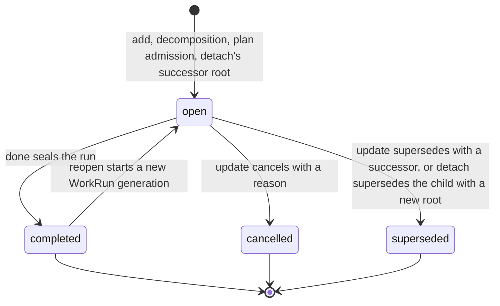
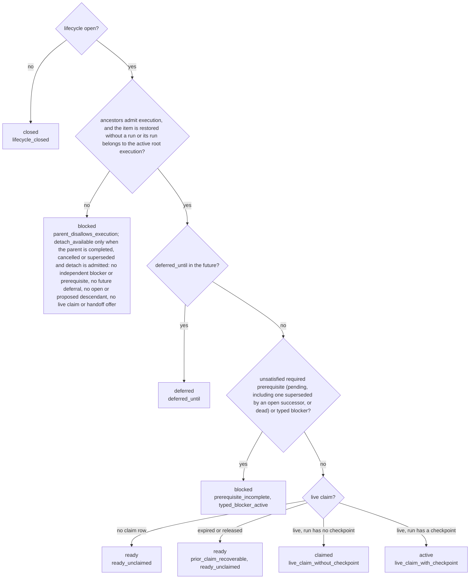
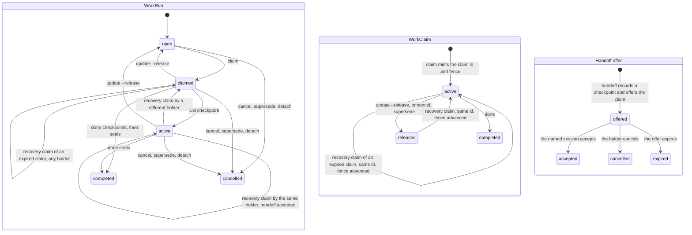
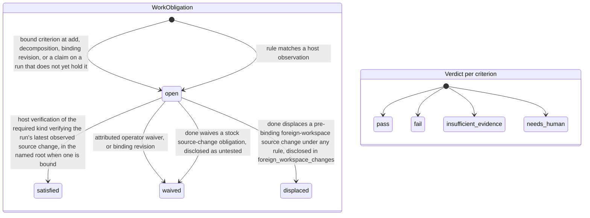
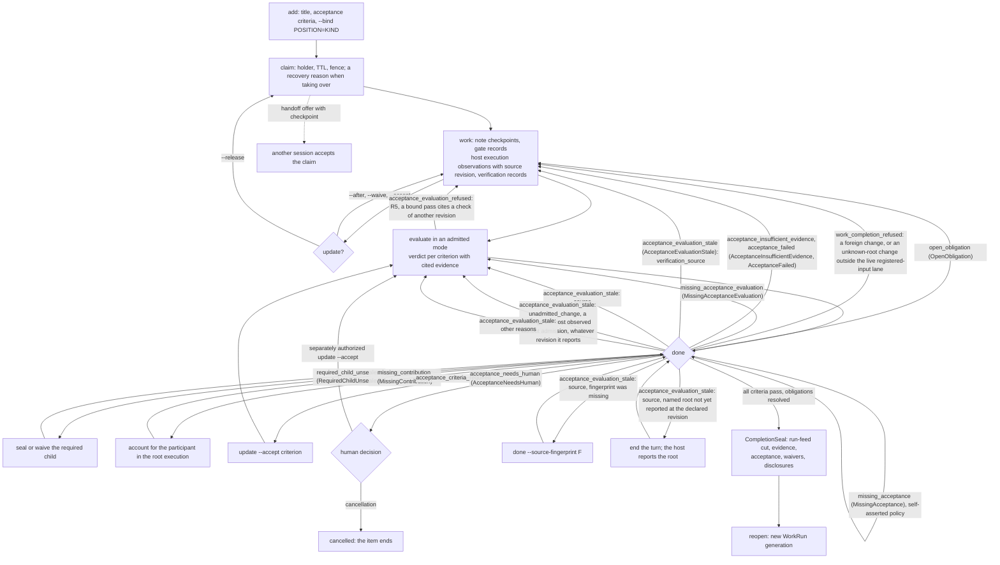

# Local Work Model and Readiness

[Local work index](local-work-system.md) · [Architecture](../architecture.md)

## Product boundary

| Component | Owns | Does not own |
| --- | --- | --- |
| Engram | Local work graph, readiness, dependencies, decomposition, claims, execution memory, evidence, completion, and publication intents | Starting/stopping model processes or silently changing external systems |
| Host runtime | Model/session lifecycle, prompt delivery, tool interception, user approvals, and recording host observations | Reimplementing work readiness or granting authority independently |
| Agent or human | Goals, judgment, proposed plans, evidence, and choices allowed by current authority | Self-minting claims, waivers, or publication permission |
| External adapter | Explicit source snapshot, optional backup/portable/sync, or separately authorized export/publication | Becoming an undeclared dependency or continuously mirroring tracker state |

The host may choose a model and start a process. Engram determines which local
work is ready and whether a selected session may act on it. Process scheduling
remains outside Engram; work scheduling belongs inside it.

## Durable concepts

### Work item

A `WorkItem` is a stable local planning identity. Its current view is derived
from immutable events and includes:

```text
WorkItem {
  work_id, short_ref, project_id, root_id, parent_id?
  title, outcome, acceptance[]
  kind, priority, labels[], assigned_to?, deferred_until?
  origin: local | imported
  source_snapshot_id?
  revision, created_by, created_at
}
```

`short_ref` is human- and model-friendly display syntax; `work_id` is the
stable collision-resistant identity. Titles, outcomes, priority, and
acceptance criteria change through attributed revision events rather than
in-place history loss. A corrupted or imported store that contains a short-ref
collision fails selection with a typed candidate list containing each full
work id, short ref, title, and lifecycle-backed `state`. CLI/MCP guidance names
up to eight ordered candidates, reports how many additional matches exist, and
requires the caller to retry with one full id; it never picks a candidate
implicitly.

`update --accept` replaces the whole acceptance list through the same revision
path, preserving omitted fields and refusing empty or blank criteria. Native
revision history derives changed planning field names uniformly from adjacent
canonical snapshots, without extra persisted revision metadata. A restored
item's first native revision compares against its immutable restore record.
Previous criteria remain in immutable events. Completed work cannot be revised.

`parent_id` expresses decomposition. A child is part of its parent's outcome;
it is not automatically a prerequisite of every sibling. Each child is
`required` or `optional` for parent completion. Parent and child remain
independently claimable work units.

Assignment is durable planning intent ("this actor should take this later").
It is neither a live work claim nor resource authority. Priority is an
explicit integer ordered by project policy and is user/policy-authorized by
default; models do not silently reprioritize the backlog. Work kind and labels
are typed/indexed fields, and children inherit configured labels.

An acceptance criterion may be **bound** to a typed verification requirement:
a `VerificationKind` (`test`, `build`, `lint`, `review`, `acceptance`) and,
optionally, one exact check, pinned by its command fingerprint — the
`check_fingerprint` the host records on verification evidence. The id of a
stored record is not one and is refused where the binding is authored.
Bindings are authored with the criteria
(`add`/`update --bind POSITION=KIND[:FINGERPRINT]`, a plan task's
`bindings`) and name criteria by one-based position: in the list as typed
when the list is authored in the same call, in the stored list `show`
numbers when bindings alone are revised. They are stored in the item beside
that list. A bound criterion is
enforced through the existing typed obligations: creating, claiming or
revising the item opens one `WorkObligation` per binding on the item's run,
triggered by that planning event; host-minted `VerificationEvidence` of the
bound kind (and pinned check) with a passed result satisfies it, with or
without a source mutation on the run. Host-minted means recorded as
registered verification through the host's work session: enforcement needs no
grant, but a host that does not run Execution Observability cannot mint that
evidence and can only revise or waive a bound requirement. `done` refuses while the obligation is open, and
refuses when the newest verification of that kind at the completion cut did
not pass, since a later failure outranks an earlier pass, or does not verify
the run's latest observed source change under the same rule that matches
verification evidence to a mutation (source revision, position and time, not
recording order alone), since it certifies code that has since moved; a change
the host recorded without a source revision offers only its recording order,
and that is what is compared. Both
checks belong to `done`; recording an evaluation does not apply them. When
the host binds a claim to a named source root, only a check captured in the
bound workspace and generation can satisfy a bound criterion. A foreign
workspace's pre-binding source change is disclosed as
`foreign_workspace_changes` in the seal with an audited `displaced`
resolution; it never becomes passing verification or an untested waiver.
A foreign change recorded under a bound name stays open until an explicit
human waiver. A change with no established workspace recorded while a root was
bound requires a fresh check in the claim's active named root or a waiver,
even after that root ended, was released or was renamed; one recorded while
no root was bound is waived as untested like any unbound change. A change in
the
root's own workspace from before the binding is satisfied by a later check of
the root's newest sighting. A later change in that root makes an older check
stale. The host records the binding and each sighting's capture-time root
generation, without deriving identity from path text; see
[named source roots](execution-observability.md#named-source-roots).
Pre-binding means by generation: a foreign change is displaced only when its
sighting's generation is absent or below the binding's. Under a later name, a
sighting stated under an earlier, still-bound name is displaced only when it
was recorded in that earlier name's own root workspace; one already foreign to
that root keeps needing the human waiver across renames, even a rename to that
very workspace. Neither a later name nor a check made while the claim is
unbound, after that root ended or the claim was released, discharges it, and
`done` on an unbound claim refuses it too. A binding lasts as long as its
claim: renewal, recovery and an accepted handoff keep it, and an
`ended` event or the claim's release ends it. After an end or a release the
claim is unbound again, and a sighting recorded on the run feed after its
generation ended or was released is never displaced: a later matching check
satisfies its change, as without a root. Displacement depends only on where
and when a change was sighted, never on which rule opened its obligation: an
operator-selected rule, even one that pins its check, is displaced and
disclosed like the stock rule. A change with no source
basis is placed by its run-feed position and is never displaced. Under a named
root, the repeat rule compares a reported change within its own workspace.
The seal binds the obligation, and an asserted criterion cites the verification
that carried it when the completion cites it. Under an evaluated policy a
bound criterion passes only on an `observed` basis citing that evidence —
never judgment or an asserted gate — and seals with exactly the citations it
was judged on. Each of those checks must have run on the source the evaluation
judged (its declared source, or else the run's newest sighting at the
evaluated cut), and the source must not have moved away by that cut: the
newest sighting after the check shows its revision, and no change without a
revision was reported after it. `evaluate` refuses any other citation, and
`done` treats a record holding one as stale
(`verification_source`), whether the binding's obligation was satisfied or
waived ([acceptance evaluation](acceptance-evaluation.md#record-time-validation),
R5 and F8). A revision that drops a binding waives its obligation in the
revising actor's name. A binding the preceding revision did not carry
unchanged — a new one, one added back after being dropped, or one whose
sentence was rewritten — owes its verification from that revision, because
an earlier pass answered an earlier authoring; `--accept` without `--bind`
drops every binding, and the receipt says so.
Free-text criteria are judged as before.

### Root execution and work run

A `RootExecution` is the aggregate execution generation for one root work
item. It owns the expected contributor roster, membership of current child
runs, required child `CompletionSeal` ids, reason-attributed waivers for
cancelled or superseded required children, root-level decisions and other
waivers, and the root completion barrier. It does not own working memory.
Each capture retains its focused `WorkItem` as the provenance subject, while
shared applicability is keyed to that item's stable root. It therefore
survives reopen and replacement execution generations and is visible from
sibling or descendant focus in the same root.

A `WorkRun` is one execution generation for exactly one work item. In V1 it
has exactly one ordinary executor and at most one live `WorkClaim`. It owns
that executor's ordered execution feed, checkpoints, evidence, and completion state. Parallel sessions execute distinct child work
runs under the same `RootExecution`; they do not share mutation authority for
one run. Root members that do not claim the focused run may inspect permitted
root memory and communicate, but cannot receive an ordinary mutation or
completion grant for that run. V1 permits at most one active run per work
item. Reopening completed work creates a new run instead of reviving stale
grants, claims, or evidence from the previous generation. Every claimed
mutation also rechecks that all ancestors remain open and that the run still
belongs to the one active `RootExecution`; a completed root therefore fences
unfinished optional descendants even when their item lifecycle remains open.

This separates durable planning identity from live execution authority.
Protocol records bind both `work_id` and `run_id`.

Root state has one immutable empty origin per execution generation. Each
change adds an immutable `work_root_delta` object with a predecessor address,
consecutive root-state sequence, previous revision, fixed metadata, exact
member additions/removals, and a checksum of the complete resulting state.
The delta is the head object; its checksum is not an object address. Events
refer to this head instead of embedding all root collections. An unchanged
root reuses its head. Runs, child seals, child waivers, contributors,
contributions, and participant waivers all support both addition and removal.
The root's `updated_at` is a recorded caller-supplied timestamp, not a clock
for ordering or authority. It is bound by canonical equality and the checksum,
but need not increase. Predecessor addresses, root-state sequences, revisions,
and dense feed positions carry the relevant order; claim expiry is separate.

Current storage keeps a fixed header/head row and separate member rows.
Readers assemble these rows and check the complete state checksum, including
missing or extra members. Historical reads follow the addressed generation
back to its origin, check consecutive deltas and every intermediate result,
and never substitute the current head. Doctor replays each generation once,
as described below; it also checks historical event references in feed order
and rejects unbound delta objects. These checks do not authorize repair of
runtime state. See [SQLite storage](sqlite-store.md).

This bounds the bytes written for a fixed-size new root fact, not the CPU
cost of reading or hashing the aggregate. Current validation remains linear
in current membership. Evidence and checkpoint writers reuse the validated
member map and pass a transaction-bound head proof to event append. A stale
proof refuses; it never reloads a different state as a fallback.
Live completion now uses a narrower validation contract for required-child
waivers. It fully checks the current root state, then follows that head's
predecessors to the empty origin. Each cited waiver must be an exact addition
on this chain and must never have been removed after that addition. Removal
followed by an identical re-addition also refuses. The read reverses all exact
member changes; it does not assume that ordinary writers are the only possible
source of canonical history. Other parents' waivers do not require a separate
historical-state read for this completion.

This live proof does not check historical full-state checksums. A re-canonicalized
historical head with a false checksum can pass the fact proof if the required
facts, chain, and current full checksum are valid. This is an explicit
narrowing of live validation, not an unchanged integrity contract. Checksum
representation and meaning have not changed.

Doctor and graph export replay each generation once, from its empty origin to
its last head. The replay checks that every delta continues the one before it,
removes only members that are present, adds only members that are absent, and
never leaves two waivers for the same child or participant. It compares the
full-state checksum at the last head only, and compares that state with the
current rows. The work is linear in the generation's deltas and their members.
Required-child waiver events are checked against the membership the same
replay recorded for their heads. A delta that changes the final state is
therefore detected. Not detected: a stored checksum of an earlier head that
disagrees with its own state while the last head agrees, and a change to an
earlier delta that leaves the chain valid and the final state unchanged. When
the last head disagrees, a second replay compares every head and the report
names the first one whose checksum disagrees, as
`work_root_delta:HEAD:first_checksum_mismatch:SEQUENCE`. A read of the root
state frozen by one completion seal still compares every head up to it.

For a fresh completion, the remaining checks have a specific scope:

- Admission, reads, proof, seal, and event share one writer transaction.
  Refusal commits no partial completion.
- The current item, run, claim, fence, holder, expiry, and active generation
  must agree with their canonical bindings. A projection is not new authority.
- The current root's complete state and every member hash are checked.
  Each used waiver must match its direct child and canonical event exactly.
- The proof checks ancestry, exact additions and removals, revision continuity,
  and reversal of the complete chain to its empty origin. It does not merely
  test whether a cited object exists.
- Checkpoint, run evidence, feed cut, acceptance, required children,
  obligations, and completion drain retain their separate admission checks.

These checks do not authenticate actors or prove that the whole store has
never been rewritten. Acceptance and evidence relevance remain author
assertions. A successful completion is not a full-store health report.

The full audit is on demand, not periodic. An explicit `engram doctor` or
`engram graph save` runs the replay described above. Projection repair also
calls `verify_all` before commit, including that replay; backup and restore
verify their copies. An operator can include an audit in installation
procedures, but installing a binary alone does not schedule one. Ordinary open
and `done` do not schedule that audit, and fixture checks in CI do not audit
the active store. A last head whose checksum is false can therefore remain
undetected until an operator or host requests a full audit; Engram does not
guarantee a maximum detection delay. A false checksum on an earlier head is
not detected by the audit at all while the last head agrees. Only a read of
the root state frozen by a completion seal compares the heads up to that seal.

The fact proof loads each delta once and hashes the current state once. Its
member work depends on the current members, requested waivers, and actual
addition/removal payloads, with map lookup costs. There is no fixed waiver
count: terminal children can accumulate while the open-child count stays low.
Tests therefore vary waiver count as well as other history. The proof does not
multiply the current-state checksum bytes by the waiver count.
The chain length is the entire current generation, not just the distance to
the oldest cited waiver. Generations do not rotate automatically; only an
explicit root reopen starts a new native generation. A root kept open can
therefore accumulate an unbounded history. This proof removes repeated
full-state hashing, not dependence on history length.

Stopping at the oldest requested waiver was considered and rejected. It would
retain a proof of the suffix implied by the current state, but would no longer
check the prefix or empty origin during live completion. The chosen contract
keeps those checks. In the scale phase's history fixture at 1,000 checkpoints
(the gate now builds 500; `ENGRAM_ROOT_DELTA_SCALE=1000` builds 1,000 on
demand), the implemented proof reduced full-state checksum input for root
completion from 103,248,645 bytes to 613,338 bytes. The full audit of that fixture hashed 257,098,620 bytes
while it compared every head; comparing the last head only, it hashes 209,661.
These are checksum-input counts, not elapsed time or the cost of scanning the
suffix.
The additional loss of prefix validation was not accepted for an unmeasured
further saving. This is a rejected design option, not unfinished work. A future
measurement of traversal cost can justify reconsidering that trade-off.

A replay walks back from the addressed head to the origin, keeping each
decoded delta, then applies the deltas in forward order. Its memory is linear
in the generation's delta payloads. Doctor and export hash the full state once
per generation. The strict read of a sealed root state hashes every
intermediate state, which is quadratic when history and membership grow
together.
Each native completion seal names the exact pre-completion `RootExecutionRef`
instead of copying root contributors, contributions, and participant waivers.
The completion delta must directly extend that head. A different head in the
same generation is not a substitute. Per-item required-child seals, waivers,
and resolutions remain in the seal because they describe that item's barrier,
not the entire root's accounting. Historical accounting reads follow the sealed
address and verify the whole history, even after a later root reopen.

The current-fence checkpoint already commits its holder and contribution to
root accounting atomically. If either fact is missing at completion, `done`
refuses with `InvalidWorkProjection` and diagnostic guidance. It does not add
the missing facts silently. This is a stricter admission check, separate from
the narrower live historical-checksum contract above. `engram doctor` is the
diagnostic entry point; projection repair cannot invent missing canonical
accounting. Any restoration requires a verified source, not a repeated `done`.

Memory scope does not recursively walk arbitrary ancestors. A shared
`Scope::Work` records the focused work id for provenance and feed routing, but
its read applicability is the verified root id. Private `Scope::Agent { work
}` scratch remains exact-item and owner-only. This lets reopen preserve shared
decisions and constraints while resetting execution state, lets sibling work
consume common root guidance, and prevents private scratch from leaking
across sibling focus.

### Work source snapshot

A `WorkSourceSnapshot` records adapter kind, canonical external reference,
captured time, source revision/fingerprint, projected fields, and canonical
payload hash plus bounded extension data. [File intake](source-intake.md)
stores a typed snapshot as provenance under a minted id. First import requires
an authored local title and outcome; it does not map external fields into
local work. Refresh records an immutable source-change notice that applies
nothing. It never overwrites local state or implicitly reopens/completes work.

### Work claims

A **work claim** reserves responsibility for a work item or run. It prevents
duplicate execution and supports assignment, heartbeat, handoff, expiry,
and recovery. It does not authorize file or external mutation. The separate
resource-lease engine has been removed; hosts and users retain mutation authority.

A successful note, update, evidence, checkpoint, or handoff by the current
holder advances work-claim expiry to at least one hour after that mutation
without shortening a longer explicit TTL. Successful
completion instead terminalizes the claim at the completion timestamp.
Keyless `claim REF [--ttl SECONDS]` explicitly renews a current holder's live
claim to `max(existing expiry, now + TTL)`, with a one-hour default. Its claim
identity and fence stay fixed; an immutable `claim_renewed` event records the
renewal. An explicit core idempotency key replays its original result instead.
Renewal is refused while a live handoff offer is pending: cancel the offer,
or let it be accepted or expire before attempting another holder mutation.
The same refusal covers holder notes (including status notes), checkpoints,
evidence, release and claim-bound planning. Fresh `allowed_next` and suggested
commands omit those actions and offer cancellation instead. Refusal details
carry the blocking `offer_id` while keeping the existing reason and remedy.
Record a WAIT or status before offering; to resume holder writes, cancel the
offer, or use the host's peer channel while waiting. Peer observation notes
remain available and do not mutate the claim or offered checkpoint. Successful
idempotent retries still replay their original receipts unchanged.
Handoff liveness uses the exact stored expiry timestamp: it remains live
immediately before that instant and expires at equality. Millisecond columns
only narrow storage candidates. Sweeps recheck the canonical timestamp before
changing state; recipient discovery excludes expired boundary candidates before
counting and limiting displayed offers. Inactive
process-session retention conservatively protects handoffs through the expiry
millisecond, so it cannot delete a still-live recipient.
A non-holder `note` on open work is a project/root observation only: it neither
renews a claim nor creates a checkpoint or run contribution. A
later `note` or `gate` is the narrow exception: any project-bound session may
append an attributed late finding to the completed run without a claim,
checkpoint, renewal, reopen, or reseal. Other holder words remain refused and
name `note` as that path rather than suggesting a reopen. A
holder mutation on a lapsed claim is refused with one recovery command:
`engram work claim <ref>`. When the work is ready, that ordinary claim command
retakes the same holder's claim under the stable project/session binding,
advances the fence, preserves an active run, and needs no recovery reason.
The session learns of the lapse before a write refuses: every agent read
(`next` and `next --peek`, `ls`, `search`, every `show` form and every
`memories` form) carries the reminder `your claim on REF lapsed; reads never
renew it; renew it with engram work claim REF` while open work's current
claim is still recorded as this session's and its expiry has passed. It names
at most one item, preferring the session's focus, then the latest expiry. It
is read in the same snapshot as the rest of the receipt (inside `next`'s
advisory cut; for the other words in the one read transaction their read-only
connection holds for the whole word), and changes nothing: no claim, fence,
expiry or focus moves, and only `claim` renews. A released, ended or
taken-over claim, terminal work, and other sessions' claims give no reminder.
The check is advisory: if it fails, the read still answers and says `could not
check whether your own claims lapsed`. Fitted reads reserve its bytes, so
their `byte_budget` is the ceiling their content was fitted to, and `next`
keeps it whole like the backup reminder. Every read with a lapsed claim
carries it. A new project-memory version is admitted with 160 bytes of room
for it in its full read, so that read fits within 12,288 bytes; versions
stored before the reserve keep the bound they were admitted under, so they
can still be revised and retried exactly. Such a stored version's `memories
KEY --full` read carries the reminder too and may then reach at most 12,448
bytes (12,288 plus the 160-byte reserve), in JSON and in text; the
worst-case history navigation its admission reserved usually absorbs it.
Every other fitted read stays within 12,288 with the reminder. The explicit
complete reads (`show --full`, full-note detail and `show --evaluation`)
remain unbounded, as before, and carry it as well.
`claim --under PARENT` (core update `claim_next_ready`) selects the parent's
next ready direct child by the same derived readiness and the `ls --ready`
order, then claims it inside that one write transaction under SQLite's single
writer, so concurrent callers are served distinct children; a child this
holder already holds under the parent is renewed instead, found from claim
metadata without reading any sibling (so a renewal's ready count is the
projection's and advisory, while a fresh selection's is verified), a ready child
lapsed under an unaccounted holder is passed over without a recovery reason,
and a call with nothing ready refuses and claims nothing.
Every handoff offer expires no later than its source claim. Expired offers are
swept inside the completing mutation transaction, so a refused completion rolls
the sweep back with the rest of that attempt. The immutable expiry event is
therefore appended at the clock of a later successful sweeping mutation; a run
with no later mutation has no expiry event even though readers already treat
the offer as expired. Taking over from a different, unaccounted holder still
requires attributed recovery.

A holder gives up its claim with `update REF --release [--reason "why"]` (MCP
`update` with `action: "release"`). A holder with neither a contribution (a
note, gate, or checkpoint made while holding a claim) nor a participant waiver
under the item's root execution must give a nonblank reason: the release
records it as the attributed participant waiver of that missing contribution,
and its receipt says so. The holder is then accounted, so the next holder
claims without `--recover`. A release without that reason is refused with
`work_release_waiver_required`, changes nothing, and names the `--release
--reason` command. An accounted holder, one that already contributed or was
waived by an earlier release, may omit the reason (the release then records
`released`), and no new waiver is written. Whether a release recorded the
waiver is stored with its result, so a replay or a receipt recovered after an
interruption reports the same decision. A waived session may claim again and
contribute; the waiver and the contribution are both kept. A claim that
expires without a contribution is not waived by its former holder afterwards:
its successor still takes over with `--recover`.

A work-bound execution turn must carry the live work claim. Shared analysis
may use an independent child claim; resource leases are not required. Root-level observation and
communication may instead use `RootExecution` membership; membership never
authorizes mutation or completion of another executor's run.

### Completion seal and report assembly claim

Every completed run produces an immutable `CompletionSeal`. Root completion
additionally binds every required child seal or an explicit
`CompletionWaiver`-authorized omission with the child's exact disposed
revision, plus the `RootExecution` roster, contributions, decisions, and
attributed waivers. Cancelling or superseding a required child never satisfies
the barrier by itself or through an unrelated replacement. The designed
[work-graph snapshot](work-graph-snapshot.md) adds the one completion proof
that is not a seal: a child loaded completed carries an inert
`RestoredRecord`, the parent seal lists it under `restored_child_completions`
beside its required seals and waivers, and report assembly refuses a root
whose completion transitively rests on one. Sealing terminalizes
the run's `WorkClaim`; completed execution authority is never kept alive for
report work. Resource leases have been removed.

A seal may also record a landing: where the completed work landed, as the
completing agent states it at `done`. It holds the commit (40 or 64 lowercase
hex), the remote and branch it was pushed to, the push time, and the build
fingerprint of the binary installed from it when one was installed. It is
asserted provenance only; the host-measured content fingerprint stays the
freshness identity. The full build value to give `done --installed-build` is
the `build_fingerprint` that the installed executable itself reports: run
`readiness --json` or `doctor --json` by the installed executable's path after
copying it, since a long-running MCP process still reports the build it
started with. `--version` shortens each token, and a shortened value is never
completed by hand. `show` prints the landing on a completed item, and the
completed item's JSON carries it as one `landing` field. The installed build is
shown in full beside "asserted, unchecked" (JSON `installed_build_assurance`),
or as "no installed build recorded" when the seal names none; the words are
derived when read, so old seals read the same way and no seal is rewritten.
Engram never compares it with any build. A seal without a landing reads "no
landing recorded", and a seal that could not be read, or a completion restored
from history, reads "unavailable" with the reason. Seals written before the
field existed carry none: they are read as stored, with no backfill, and their
landings stay in the prose landing notes (commit, gate run and freeze
fingerprint), a practice that remains valid beside the typed record. A landing
made after `done` is recorded the same prose way, because the seal is frozen:
`done` naming a landing its seal does not already record is refused as a late
finding. On request only, `engram doctor
--check-landings [--repo PATH]` asks a local repository whether each recorded
commit exists under exactly its recorded id and lies on the named remote
branch's remote-tracking ref. It never fetches, and names an absent commit, a
commit off the branch, or a remote-tracking ref not present locally; a git call
that fails, as in a damaged repository, leaves the landing unverifiable, as does
a commit not found on the branch of a shallow repository, whose cut history may
hold it. Apart from Git's answer, it prints each landing's installed build as
`show` does, in full beside "asserted, unchecked"; the build never enters the
verdict and is never compared with the executable running the check. When the
repository cannot be read, every landing is still listed with its installed
build, each marked as not checked, except one whose stored shape fails
validation, which reads malformed. An absent installed build has two JSON
shapes on purpose: the check's report gives every landing the same members
and writes `installed_build: null`, while `show` and the `done` receipt keep
the seal's own shape and omit the member. Both carry
`installed_build_assurance` "no installed build recorded".

Every new seal also declares completion-obligation schema V1 and records the
exact `(definition, terminal resolution)` pairs applicable at its pre-seal
dense run-feed cut. First, each still-open obligation of the stock
source-change rule is resolved as a waiver in the completing actor's name,
inside that cut, unless a named root, active now or bound when the change was
recorded, changes its disposition. A pre-binding foreign change receives an
audited `displaced` resolution under the stock rule and any operator-selected
one alike, and is disclosed separately, once. A foreign change
recorded under a bound name stays open for an explicit human waiver, even
after that root ended or the claim was released; an unknown-root change
recorded while a root was bound needs a fresh check in the claim's active
named root or that waiver, and with no root active `done` refuses it. In the
ordinary unbound case,
or after a [live registered-input decision](acceptance-evaluation.md#registered-git-input-evidence)
has checked the named root for an unlocated stock report,
a source change with no matching passing test is recorded as untested instead
of refusing ([obligations from source
changes](execution-observability.md#obligations-from-source-changes)). Any other open
obligation refuses sealing before any terminal work mutation. A required child
seal is decoded and checked recursively, and every accepted seal carries the
current obligation-schema binding.

Post-completion `note` and `gate` evidence is appended after that immutable
cut. It reuses the sealed claim identity and fence only as historical binding,
while its `ActorContext` names the current project-bound session and carries a
`work_evidence:post_completion` / `post_completion` marker in the existing
provenance chain. The late evidence appears in `show` and project/run feeds,
but never enters the old seal, mutates root contributions, adds a completion
barrier, or makes completed work active again.

New seals also declare environment schema V1 and bind the exact sorted,
distinct set of environment-evidence ids visible at the same dense cut.
The set is capped at 64 and contains ids only: canonical toolchain,
sandbox/image, workspace, and capability-map components remain in their own
evidence objects. Every accepted seal carries the current environment-schema
binding. Environment identity is audit evidence: an environment record
belongs to one run and one source revision, so no requirement can name one.

Optional report assembly therefore uses a distinct post-completion authority:

```text
ReportAssembly {
  assembly_id, root_id, root_execution_id, completion_seal_hash
  generation, state, revision
}

ReportAssemblyClaim {
  claim_id, assembly_id, generation, holder
  expires_at, revision, fence
}
```

The planned assembly claim is not a work claim and does not permit
ordinary workspace mutation. Assembly binds the completion seal,
assembly generation and revision, and live assembly-claim fence; no finalizer
turn purpose or phase exists in the host protocol.
Handoff, expiry, and recovery advance that fence. Reaching `report_ready`
terminalizes the claim and freezes the report bytes.

## Lifecycle and derived readiness

Engram does not squeeze planning, availability, execution, and publication
into one status field.

The shipped alpha lifecycle is:

```text
open -> completed
  |\-> cancelled
  \--> superseded

completed --reopen--> open with a new WorkRun generation
```

`proposed` is a declared lifecycle word: ordinary creation, decomposition and
plan admission persist `open`, and executable operations refuse a proposed
item; a graph-snapshot restore may persist it and a planning revision admits
it, so it can exist without a shipped operation that admits it into `open`.

The target controlled-completion lifecycle inserts `completion_pending`
between `open` and `completed` only when Engram must drain mediated actions. That state is not emitted by the shipped zero-linked-
state completion path.

Availability is a derived projection over the open item:

- `ready`: admitted, not deferred, required prerequisites complete, required
  parent constraints satisfied, and no active claim.
- `claimed`: a live claim exists but no first execution checkpoint has landed.
- `active`: claimed and execution has checkpointed progress.
- `blocked`: at least one typed blocker remains. Blockers may be a prerequisite
  work item, a required human decision, missing external input, policy, or a
  manually recorded condition.
- `deferred`: a future wake time or explicit wake condition is active.
- `waiting`: a declared word for work that intentionally waits for a named
  event while retaining responsibility; unlike `blocked`, it would not be
  advertised for reassignment. No shipped derivation reports it.

Operational indexes cover open/closed/proposed work, assignments, labels,
blocked/stale/orphaned items, statistics, and preflight integrity. The ambient
ready view ranks admitted work by priority, the number of open dependants it
can unblock, age, and stable id. Its candidate limit is applied in SQLite before
item projections are decoded. Catalog assignment and label keys use NFC plus
full Unicode case folding; trigram FTS covers title, outcome, labels, short
reference, and active-blocker detail. Deferral has an explicit time or event
wake condition; reaching it only recomputes readiness and does not auto-claim
or start a process.

### State diagrams

The diagrams below use the state words of `src/domain/work.rs` and
`src/domain/acceptance_evaluation.rs` and draw only transitions a shipped
write or derivation performs. Each layer is a separate projection; none of
them is folded into another.

The durable planning lifecycle (`WorkLifecycle`). `add`, decomposition, plan
admission and detach's successor root persist an item as `open` directly;
`proposed` has no edge here because no shipped operation admits it (see the
note above the availability list):



Availability (`WorkAvailability`) is not a state machine: every read derives
it from the item, its edges and its claim, in this precedence, and reports the
matching readiness reasons (`WorkReadinessReason`). A held item that gains a
blocker reports `blocked` and returns to `claimed` or `active` when the blocker
clears; an item created with an open prerequisite starts `blocked`; `done`
closes a `claimed` item as well as an `active` one, because completion
checkpoints before it seals; cancel and supersede close from any availability
only after any live handoff offer has been cancelled, accepted, or expired.
`waiting` is a declared word that no shipped derivation reports. Agents see
`claimed` as the word `held`.



Execution: one `WorkRun` per generation, one fenced `WorkClaim` per run, and a
checkpoint-coupled handoff offer (`WorkRunState`, `WorkClaimState`,
`WorkHandoffState`). Expiry changes neither object: an expired claim stays
`active` with its `expires_at` in the past and availability derives
`prior_claim_recoverable`; the next claim reuses the same claim id with the
fence advanced, whether the prior claim expired or was released. Cancel and
supersede refuse while a live handoff offer exists; otherwise they cancel the
run from any state and release an active claim, live or expired. Historical
offers on disposed work remain stored, but are not current handoffs; fresh
acceptance and cancellation are refused by the item's name and lifecycle.
Committed handoff receipts still replay unchanged. Detach is admitted only
without a live claim or handoff offer; it cancels the run and leaves the claim
as it stands.



Obligations (`WorkObligationState`) open in two ways: a criterion bound with
`--bind` opens its obligation at creation, decomposition, a revision that adds
or rewrites the binding, or a claim on a run that does not yet hold it (a
reopened generation); and an obligation rule opens one when it matches a host
observation. An obligation is satisfied by host verification of the required
kind that verifies the run's latest observed source change; it is waived by an
attributed operator waiver or a revision of the binding. A stock source-change
obligation with no matching passing check is waived by `done` itself in the
completing actor's name and disclosed in the seal as an untested change; a
binding obligation is never waived that way. Under a named root, verification
counts only in the bound workspace and generation, and `done` displaces a
source-change obligation, of the stock rule or an operator-selected one, whose
trigger was sighted in another workspace before the binding: it is neither
satisfied nor waived, and the seal lists the change once in
`foreign_workspace_changes`. A foreign change recorded under a bound
name stays open for an explicit human waiver; an unknown-root change recorded
while a root was bound needs a fresh check in the active named root or that
waiver; until then `done` refuses, even after that root ended or the claim was
released. The verdict an acceptance evaluation
records per criterion is `AcceptanceVerdict`.
The [live registered-input lane](acceptance-evaluation.md#registered-git-input-evidence)
excepts an unlocated report from that barrier: Git's named-root read decides,
and changes outside that root are not seen by it. Located foreign guards remain.



The word-level flow from creation to seal, with the completion refusal each
gate answers. The refusal labels are the words a receipt carries: the `kind`
of a typed recovery cause of `WorkCompletionRecoveryCause` (its Rust name in
parentheses), the `acceptance_criteria_required` error of
[acceptance evaluation](acceptance-evaluation.md), and the
`work_completion_refused` error a named root raises for a source change it
cannot account for. A completion refusal's
top-level `code` equals its cause `kind`, except `open_obligation`, whose code
is `open_work_obligations`. The refusal at `evaluate`
is `acceptance_evaluation_refused`, applying that document's recording rule R5
(a pass on a bound criterion may cite only checks of the judged source), which
`done` applies again as freshness rule F8 under the stale reason
`verification_source`. The evaluator modes are `same_session`, `sub_agent`
and `independent_session`.



Under a self-asserted policy the `evaluate` step is absent and `done` records
the holder's own acceptance, refusing `missing_acceptance` (`MissingAcceptance`)
when a criterion is left unaddressed. Under an evaluated policy the host runs the evaluator and the
core enforces the verdicts; Engram never calls a model.

The flat `ls` word reads its filtered count, bounded page, and displayed
holders in one read transaction. Only this counted listing pays for a total;
ambient `next` and held-item catalogs stay bounded. Assignment and live-session
holding form a deduplicated union for `--mine`, alongside the other filters
and counted once before the page limit. Its exact `total`
is independent of the limit; `omitted` is total minus emitted rows after
final byte fitting on the first page. Later pages also report `shown_before`;
`omitted` is the exact remainder after that prior prefix and the current rows.
The footer includes the active limit and byte ceiling. Continuation is a
`ls --after CURSOR` token bound to the last emitted key, normalized
filters, project, the observed time, and a fingerprint of the listing's
complete selected sequence: every matching item in listing order, with its
priority under ready order. Ordinary catalog ordering
remains ascending work id; `ls --ready` uses priority then work id. Neither
is a dense feed ordering or an execution cursor.

`--blocked` excludes completed, cancelled and superseded work, including
restored items, even with `--all`. Their historical blockers remain stored
and inspectable through `show` and unfiltered `ls --all`. Proposed work
retains its existing treatment; deferred work with an independent blocker
still matches. This is a query filter, with no lifecycle events or row changes.

The token is opaque to the caller but not confidential: it encodes readable
filters, project and session context, without encryption. It is navigation,
not authentication, and creates no server-side state or canonical object.
Oversized continuation metadata refuses explicitly rather than emitting a
false zero-row page; the error gives the fresh same-filter command and asks
the caller to shorten filters. A continuation recomputes that sequence at
the current time in the same snapshot as its page and is refused with
`work_catalog_cursor_invalid` and a fresh same-filter command exactly when
the sequence changed: an item entered or left the filtered set, an equal
count of items was replaced, or the order moved, including through a time
transition such as a deferral ending or a claim expiring under `--ready` or
`--mine`. A reversed clock refuses too. A write that changes no member or
order, such as a note on any item or a new item outside the filters, does
not refuse, and neither does a focus-only read. Restarting costs one fresh
listing with the same filters; rows already read may appear again. Holder
words are read at each page's own time. An `ls` token carries only its
observed time beside the fingerprint, and checking it reads no project-wide
expiry. Compact `next`'s ready navigation reads no complete sequence, so it
mints its continuation with the project cut instead: the project-feed
position, the observed time and the next project claim/handoff expiry or
deferral boundary. Any project-feed advance, such as a note on an unrelated
item, or crossing that boundary (including the whole millisecond containing
it, since the observed time retains sub-millisecond precision), refuses it.
Every token names its basis; a token in the shape an earlier build minted is
refused with fresh navigation. Count, cursor validation, page and holders
share one snapshot: one ordered pass over the selected sequence yields the
total, the shown-before count, the anchor check and the fingerprint
together, and a second reads the page.
`ls --under PARENT` selects direct children only; `--optional` or `--required`
narrow that scope and require the parent. Both switches together are refused.
Ambient catalogs remain count-free and keep their existing keyset contract.

Parent `show` receipts summarize the complete direct-child set in that read's
snapshot, before the ordinary child list is limited. When that generic children
line omits rows, text and JSON name `engram work ls --under PARENT --all`. The reusable
`child_obligations` groups distinguish `required_owed` (unfinished required
children and disposed required children without current revision-bound waivers
or qualifying successor resolution)
from `open_optional` follow-ups, which never block completion. Completed native
or restored children are not owed. Both groups remain present on every item
with direct children, including zero counts; leaves have no block. Each group
retains its exact total, up to five refs, exact omitted count and traversal
command even when final text/JSON byte pressure removes rows. Required traversal
uses `ls --under PARENT --required`, with `--all` when any owed child is disposed
so terminal siblings remain reachable; optional traversal uses
`ls --under PARENT --optional`. Disposed owed refs under an Open parent name
the explicit required waiver remedy; terminal parents instead direct the
caller to inspect retained child context with `show CHILD`. Other refs also
offer `show CHILD`. This does not change completion authority or perform a
claim or waiver. See the
[agent receipt contract](cli-and-mcp.md#using-engram-as-an-agent).

Completion is local and final for that run. Report readiness and external
publication are separate projections; a work item can be completed with no
report or target, and publication failure never makes completed work active
again.

Completion suggestions in `show`, `next`, and mutation receipts are advisory.
They use indexed current child/run/seal bindings and the canonical-bound root
execution's current waivers, without replaying root history or recursively
verifying child completion proofs on each read. A missing seal binding for a
listed required child stops the suggestion. Actual completion still verifies
the full canonical seal and waiver proofs inside its transaction; `doctor`
runs the full audit. A suggestion never substitutes for
those checks or grants authority.

The suggestion remains conservative for required children completed through
restored records: it does not count those records, so it can omit `done` even
when actual completion accepts their restored completion proofs.

Every completed run has a `CompletionSeal`: accepted work revision, run and
claim fences, dense completion-cut position, executor checkpoint state,
reconciled action outcomes, acceptance
results, evidence ids, and the exact terminal obligation basis. The shipped
seal also carries the exact bounded environment-evidence id set at that cut.
`work_complete` requires the linked
action-outcome drains and the historical resource-lease drain field to be empty, terminalizes the work
claim, and seals atomically. A root seal also consumes each required child seal
or explicit reason-attributed disposed-child waiver and all root contributions.
Before that seal can land, every descendant claim and handoff offer must be
released, completed, cancelled, or expired. Unfinished optional children are
recorded in the seal and remain non-executable audit records under the closed
root. They must be disposed leaf-first before the completed root can reopen;
the new root execution never adopts their old runs implicitly.
Successful agent `done` receipts inspect direct open optional children at one
post-completion read cut and return a bounded group with an exact total and
omitted count. Each shown child has an admitted detach command or resolve-first
guidance for its actual constraint (descendants, ownership, blockers,
prerequisites, or deferral). The receipt offers parent inspection and the broader
blocked-work listing; it does not mutate children, old claims, or the seal.
This current advisory view is separate from the immutable optional-child basis
recorded in the seal. See the [receipt shape](cli-and-mcp.md#using-engram-as-an-agent).
Nonempty drain/reconciliation will use the planned `completion_pending`
protocol; it is refused today rather than silently accepted. Optional report
assembly consumes the root seal under a
`ReportAssemblyClaim` and never performs a second execution drain.

## Graph invariants

Every graph-changing command is one SQLite transaction with an expected work
revision and idempotency key.

- Parent/child edges must form a forest. Explicit prerequisite edges plus the
  implicit completion edge `parent requires required-child` form one
  **completion-dependency graph**, which must remain acyclic. Every hierarchy,
  required/optional, or prerequisite mutation checks that union in the same
  transaction. Optional children create no implicit completion edge. The API
  names explicit edge direction as `work requires prerequisite`; it never
  exposes an ambiguous `blocks(A, B)` verb.
- Required children must be completed or explicitly waived before their
  parent can complete. Optional children may remain open but are surfaced in
  the completion receipt. Root sealing refuses live descendant claims or
  handoff offers, and root reopen refuses unresolved open descendants, so an
  old child run can never cross into the next root-execution generation.
- The agent word `add --under REF` creates a required child by default;
  `add --under REF --optional` records an optional child, and `show REF` marks
  that distinction without requiring a lower-level decomposition request.
  Under a foreign-live-held parent, project-bound peers may create only
  optional children and may not add prerequisite edges. These are ordinary
  Open, unclaimed children with an exact derived proposal marker in their
  canonical creator/event provenance, visible to the holder in `next`.
  This branch changes root child-run membership and creation feeds only;
  it preserves the parent's item, run, claim, expiry, fence, and checkpoint.
  The holder can claim, revise, or cancel it, or create a separate required
  child. Optional-to-required promotion is not implemented; no approval
  queue or activation exists.
  Required or prerequisite-bearing peer plans receive a typed
  `work_peer_decomposition_refused` directing them to the parent holder.
  Holder and unclaimed-parent decomposition retain their ordinary rules.
  Peer admission requires project authority, an attributed session, and a
  foreign Active, unexpired parent claim; every child must be optional and
  no prerequisite edge may be supplied. A pending handoff offer is irrelevant
  to this peer-only path and is neither expired nor changed. The core's
  expected-parent-revision guard still rejects stale requests, but peer
  creation does not advance the parent's revision or consume its authority.
  Repeatable `add --note TEXT` records initial non-holder observations in
  creation's transaction, for roots and children alike. The ordered list is
  part of the creation intent: a failed append rolls back the entire graph
  change. Exact creation replay under the
  [session and intent retry rule](local-work-protocol.md#agent-native-protocol) does not append
  observations again.
  Repeated identical entries each record an observation. One creation or
  decomposition accepts at most 16 initial notes in total, across all its
  children. Count and blank-entry validation precede writes; refusals name
  the limit/count or the invalid note and child indices. Initial notes confer
  no claim, checkpoint, or execution credit.
  Both forms refuse terminal parents with the typed `work_parent_not_open`
  remedy: file an independent root follow-up or add under an open ancestor.
  Proposed parents also refuse new children, but their remedy is to inspect
  the not-yet-open parent, not to file a terminal-parent follow-up.
  The transaction checks lifecycle before creating any child; existing
  children, claims, and completion fences are unchanged.
- A completion binds the accepted work revision, run generation, claim fence,
  latest checkpoint cursor, acceptance results, and evidence ids. Any
  change to those facts makes an unconsumed completion decision stale.
- A run has one ordinary executor and at most one live ordinary work claim. A
  session may inspect or hold claims on multiple items under policy, but it
  focuses one claimed work item at a time. Parallel
  executors claim distinct child runs. Changing focus never releases a claim.
- Claim handoff, same-holder retake, and foreign-holder recovery increment a
  monotonic claim fence. Old sessions cannot complete or mutate after transfer
  even if their process resumes.
- Work created below a parent inherits its project, root, sensitivity floor,
  authority ceiling, non-waivable constraints, and publication restrictions.
  A child cannot relax its parent.
- Decomposition requires the parent's claim or the ordinary project-bound
  planning path. Children activate under the same project lifecycle rules. A
  one-child "decomposition" revises the parent instead.
- Project-bound sessions may complete, waive, cancel, reopen, and recover
  local work; exception paths retain attributed reasons and immutable audit
  events. External publication still requires an explicit human decision, and
  a host may independently raise the bar for material external actions.
- Exact duplicate creation is prevented by idempotency. A normalized
  parent/outcome fingerprint surfaces likely semantic duplicates before
  admission; it warns or creates a proposal rather than silently merging.
- Decomposition is bounded in code: maximum depth, children per atomic plan,
  open descendants per root, and prerequisites per item. Hitting a bound
  returns a typed directive to consolidate the plan; there is no grant or
  override token.
- Cross-project hierarchy and prerequisites are out of V1. An external or
  cross-project dependency is represented as a typed blocker with provenance,
  not a fake local edge.
- Releasing, handing off, or recovering a claim increments its fence and
  invalidates stale work-bound authority.

Every admitted change appends a canonical `WorkEvent`. New events bind the
complete post-transition prerequisite and active-blocker basis by hash, so a
claim-validated mutation can verify the current relation projection without
replaying the item's whole history. Project, root-work, and run-execution
feeds each allocate a dense per-feed position in the event transaction; their
work-event entries carry a verified item id for bounded exact-item lookup. The
item projection also retains the latest event id; operational reads require
it to equal the newest indexed feed entry, and a schema trigger prevents any
work-event append without an item id. Delivery pages have their own dense
per-session sequence. A position is always carried with its feed kind and id.
A delivery position is separate from the vector of source-feed positions
represented by that delivery. A global database row id is not a cursor. Object
hashes reproduce content but never order changes. `engram doctor` and recovery
still replay all retained history and compare it with
those bindings. The serial scale regression covers claim, evidence,
checkpoint, revision, block/unblock, handoff, completion, and `work_next` over
500 items and 5,000 events, including one 500-event item, with a fixed
canonical-decode budget.
